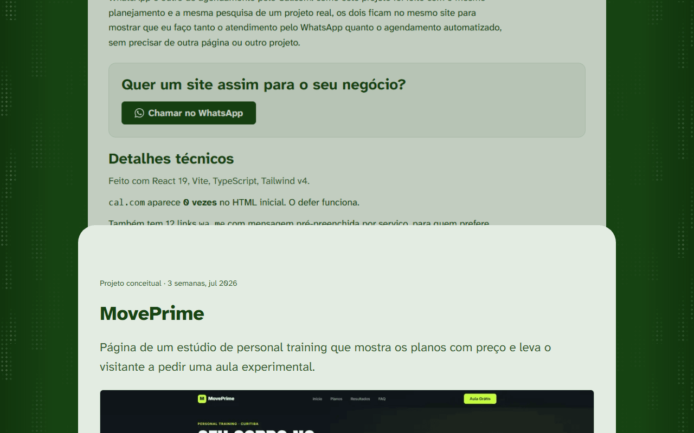

# João Vittor Lara

[](https://astro.build)
[](https://www.typescriptlang.org)
[](https://developer.mozilla.org/pt-BR/docs/Web/CSS)
[](https://lenis.darkroom.engineering)
[](https://vercel.com)
[](https://nodejs.org)
[](#licença)

Faço sites para pequenos negócios e profissionais autônomos. Este repositório é
o meu próprio site.

**No ar em [joaovittorlara.vercel.app](https://joaovittorlara.vercel.app).**


| Projetos em pilha, no desktop | Início, no celular |
|---|---|
|  |  |

## Sobre o site

É a minha vitrine: o que eu faço, três projetos de demonstração, as ferramentas
que uso, a minha formação e as formas de falar comigo (WhatsApp, e-mail ou
formulário). Foi pensado primeiro para o celular. Sou de Curitiba e atendo online.

O que eu entrego a quem me contrata: página de apresentação, agendamento online
e contato pelo WhatsApp.

O site tem quatro páginas:

- **Início:** o que eu faço, os projetos, as ferramentas que uso, formação e contato.
- **Projetos:** os três projetos empilhados numa página só. Cada card para quando
  chega ao fim da tela, e o próximo sobe por cima.
- **Privacidade:** o que o formulário de contato coleta, por quanto tempo e como
  pedir exclusão.
- **404:** uma página de erro que devolve a pessoa para os projetos ou para o contato.

## Projetos

Os três são projetos conceituais: criei como se fossem para negócios de verdade,
para mostrar como eu trabalho.

| Projeto | O que faz | Stack | Links |
|---|---|---|---|
| **Barbearia Elliot** | O cliente vê o preço de cada serviço e marca o horário sem precisar ligar. | React 19, Vite, TypeScript, Tailwind v4 | [Site](https://barbearia-elliot.vercel.app/) · [Código](https://github.com/JoaoVittorLara/barbearia-elliot) |
| **MovePrime** | Estúdio de personal training: planos com preço lado a lado e pedido de aula experimental. | HTML, CSS e JavaScript, sem dependência | [Site](https://moveprime.vercel.app/) · [Código](https://github.com/JoaoVittorLara/moveprime) |
| **Auróra Arquitetura** | Cinco páginas, portfólio de obras e pedido de orçamento que chega direto no e-mail. | Vite, TypeScript, Tailwind | [Site](https://aurora-arquitetura.vercel.app/) · [Código](https://github.com/JoaoVittorLara/aurora-arquitetura) |

## Stack

- **Astro 7**, em modo estático: cada página sai pronta do build, sem servidor.
- **TypeScript** nos scripts e nos dados, no modo estrito do Astro.
- **CSS puro**, com variáveis (tokens) em `src/styles/global.css`. Sem Tailwind e
  sem biblioteca de componentes.
- **Lenis** para a rolagem com inércia. É a única biblioteca de terceiros no
  JavaScript do navegador: o arquivo que a contém pesa 5,8 KB em gzip.
- **`@astrojs/sitemap`** para gerar o `sitemap-index.xml`.
- **Web3Forms** para o formulário de contato, sem servidor próprio.

São três dependências de produção: `astro`, `@astrojs/sitemap` e `lenis`.

Além disso, o site:

- **Hospeda as fontes.** Atkinson Hyperlegible Next e JetBrains Mono são baixadas
  no build e servidas pelo próprio domínio. Nenhuma requisição para o Google
  Fonts.
- **Não usa cookie nem analytics.** Ninguém é rastreado. Nas rodadas do
  Lighthouse, todas as requisições da página inicial e de `/projetos/` foram para
  o próprio domínio.
- **Usa JavaScript só onde há interação ou efeito de rolagem.** O conteúdo é HTML
  e CSS.
- **Gera o SEO no build.** Título, descrição e Open Graph por página, dados
  estruturados (`Person` e `Service`), sitemap e `robots.txt`.

## Rodando localmente

Precisa de Node.js 22.12 ou mais novo.

```sh
npm install
cp .env.example .env   # e coloque a sua chave do Web3Forms no .env
npm run dev            # servidor local em http://localhost:4321
npm run build          # gera o site em ./dist
npm run preview        # abre o build localmente
```

## Decisões técnicas

### A chuva de fundo move só `transform`

O efeito nasceu de um CSS do Uiverse.io que anima `background-position` de 36
gradientes e aplica `backdrop-filter` na tela inteira. Medi 1,1 quadro por
segundo a 1280x800, num Chromium sem GPU. Reescrevi com três faixas de seis gotas
deslocadas por `transform`, que o navegador resolve no compositor, sem repintar.
A posição de cada gota é sorteada no build, com semente fixa: não há `Math.random`
nem JavaScript no navegador. No mesmo teste ficou em 37 quadros por segundo a
1280x800 e 60 a 390px. Com seis faixas eram 20, com uma, 60. Não testei em GPU de
verdade.

Um detalhe que custou caro: uma duração escrita como `calc(altura / velocidade *
1s)` mistura pixels e segundos, e o navegador descarta a animação inteira sem
avisar. A duração de cada faixa já sai pronta do build.

### A pilha de projetos usa `position: sticky` com `top` negativo

Cada card trava com o fim dele no fim da tela, e o próximo sobe por cima. O
`bottom: 0` não serve: ele puxa o card para cima antes de a pessoa chegar nele.
Quem segura depois de passar é o `top`, e para um card mais alto que a tela o
valor é negativo (altura da tela menos altura do card). O CSS não sabe a altura
do próprio elemento, então essa conta é o único trecho da pilha em JavaScript,
com um `ResizeObserver`. O recuo do card de trás é uma animação ligada à rolagem
(`animation-timeline: scroll(root)`), nativa do navegador. Não uso `view()`
porque ele mede a posição do elemento na tela, e um card travado não se move.

### O vídeo fica por cima da imagem

Cada projeto tem uma gravação de tela, de 1,3 a 3,1 MB. O que conta para o
carregamento continua sendo a imagem otimizada, que está no HTML. O vídeo é só um
reforço por cima: sem tag `source`, com `preload="none"`, e o script só pede o
arquivo depois do evento `load` e quando a capa aparece na tela. Em `/projetos/`,
quem lê o primeiro projeto não baixa os outros dois. Quando o vídeo toca, aparece
um botão de pausar, porque vídeo automático de mais de 5 segundos precisa de um
jeito de parar (WCAG 2.2.2).

### O site respeita "reduzir movimento"

Com `prefers-reduced-motion: reduce`, a chuva para, a rolagem com inércia nem é
criada, a faixa de ferramentas vira uma lista parada, os blocos já nascem visíveis
e nenhum vídeo é baixado. A configuração vem do sistema. No Windows, é
**Configurações, Acessibilidade, Efeitos visuais, Efeitos de animação**: se o
site aparecer parado no seu computador, confira essa chave.

### A chave do Web3Forms é pública, e está certo

Num site estático o envio sai do navegador, então a chave aparece no HTML do
formulário. É assim que o Web3Forms funciona ("Access key is public", na
documentação deles), e quem a copiar só consegue enviar e-mails para o dono dela.
Ela fica no `.env` por organização, declarada em `astro.config.mjs` com
`astro:env`: sem a variável, o build falha de propósito em vez de publicar um
formulário sem chave. Não ofusquei, porque ofuscar não protege nada. Contra spam,
o formulário tem um honeypot e o Web3Forms filtra os envios.

## Estrutura

```text
public/                  # favicons e a imagem de prévia do link (og.png)
docs/                    # as capturas de tela deste README
src/
├── consts.ts            # dados que aparecem em mais de um lugar (URL, contato, formação)
├── content.config.ts    # formato de cada projeto
├── content/projetos/    # um arquivo .md por projeto
├── lib/                 # formatação de medidas e link do WhatsApp
├── layouts/Base.astro   # <head>, SEO, Open Graph, dados estruturados
├── pages/               # início, projetos, privacidade, 404 e robots.txt
├── components/          # cada parte da página em um componente
├── assets/              # imagens (otimizadas no build) e os vídeos dos projetos
└── styles/global.css    # cores, espaçamentos e tipografia
```

## Resultado

Medido em 16/10/2026 com o Lighthouse 13.5.0 (o motor do PageSpeed Insights), no
Chrome 155, rodando no meu computador. A emulação é a padrão do Lighthouse: no
celular, um aparelho de gama média (CPU 4 vezes mais lenta e rede 4G lenta
simulada); no desktop, sem limitação. As rodadas alternam entre local e produção.
Na página inicial são cinco rodadas no celular e três no desktop, e em
`/projetos/`, três e três. A nota é a mediana, e entre parênteses ficam as notas
de desempenho de cada rodada, em ordem crescente. O PageSpeed Insights da web
usa o mesmo motor, mas roda nos servidores do Google, então os números dele
podem diferir destes.

"Local" é o `npm run preview` em `127.0.0.1`, do mesmo build que está no ar.
"Produção" é [joaovittorlara.vercel.app](https://joaovittorlara.vercel.app).

| Alvo | Página | Plataforma | Desempenho | Acessibilidade | Boas práticas | SEO |
|---|---|---|---|---|---|---|
| Produção | Início | Celular | **100** (95/97/100/100/100) | 100 | 100 | 100 |
| Produção | Início | Desktop | **100** (100/100/100) | 100 | 100 | 100 |
| Produção | Projetos | Celular | **98** (98/98/98) | 100 | 100 | 100 |
| Produção | Projetos | Desktop | **100** (100/100/100) | 100 | 100 | 100 |
| Local | Início | Celular | **97** (97/97/97/98/99) | 100 | 100 | 100 |
| Local | Início | Desktop | **100** (100/100/100) | 100 | 100 | 100 |
| Local | Projetos | Celular | **99** (98/99/99) | 100 | 100 | 100 |
| Local | Projetos | Desktop | **100** (100/100/100) | 100 | 100 | 100 |

Métricas de carregamento, da rodada mediana de cada linha:

| Alvo | Página | Plataforma | FCP | LCP | TBT | CLS | SI |
|---|---|---|---|---|---|---|---|
| Produção | Início | Celular | 1,06 s | 1,36 s | 35 ms | 0 | 1,33 s |
| Produção | Início | Desktop | 0,33 s | 0,39 s | 0 ms | 0 | 0,45 s |
| Produção | Projetos | Celular | 1,00 s | 1,67 s | 39 ms | 0 | 3,91 s |
| Produção | Projetos | Desktop | 0,27 s | 0,41 s | 0 ms | 0 | 0,48 s |
| Local | Início | Celular | 1,57 s | 1,85 s | 80 ms | 0 | 4,00 s |
| Local | Início | Desktop | 0,35 s | 0,42 s | 0 ms | 0 | 0,40 s |
| Local | Projetos | Celular | 0,97 s | 1,99 s | 2 ms | 0 | 2,40 s |
| Local | Projetos | Desktop | 0,27 s | 0,43 s | 0 ms | 0 | 0,45 s |

Três observações sobre os números:

- **O celular local fica atrás da produção na página inicial** (Speed Index de
  4,0 s contra 1,3 s). É o mesmo build, então a diferença vem do servidor, não do
  código: o preview local não é um CDN. Por isso confio mais nos números de
  produção.
- **O maior elemento da tela** (LCP) é o `h1` na página inicial e a imagem de
  capa em `/projetos/`, nas 28 rodadas. O vídeo nunca foi o LCP.
- **`/projetos/` transfere 3,3 MB no celular, e 3,1 MB (94%) são o vídeo do
  primeiro projeto**, que só é pedido depois do `load`. Ele não pesa nas métricas
  acima, mas pesa no plano de dados de quem abre a página. Reexportar esse vídeo
  com mais compressão é o ganho mais barato que sobra.

## Contato

- Site: [joaovittorlara.vercel.app](https://joaovittorlara.vercel.app)
- E-mail: [joao.laraa15@gmail.com](mailto:joao.laraa15@gmail.com)
- LinkedIn: [João Vittor](https://www.linkedin.com/in/jo%C3%A3o-vittor-7b445631b/)
- GitHub: [@JoaoVittorLara](https://github.com/JoaoVittorLara)

## Licença

Todos os direitos reservados. O código está aberto para leitura e estudo, mas o
design, os textos, as fotos e as marcas não podem ser reaproveitados sem
autorização.
